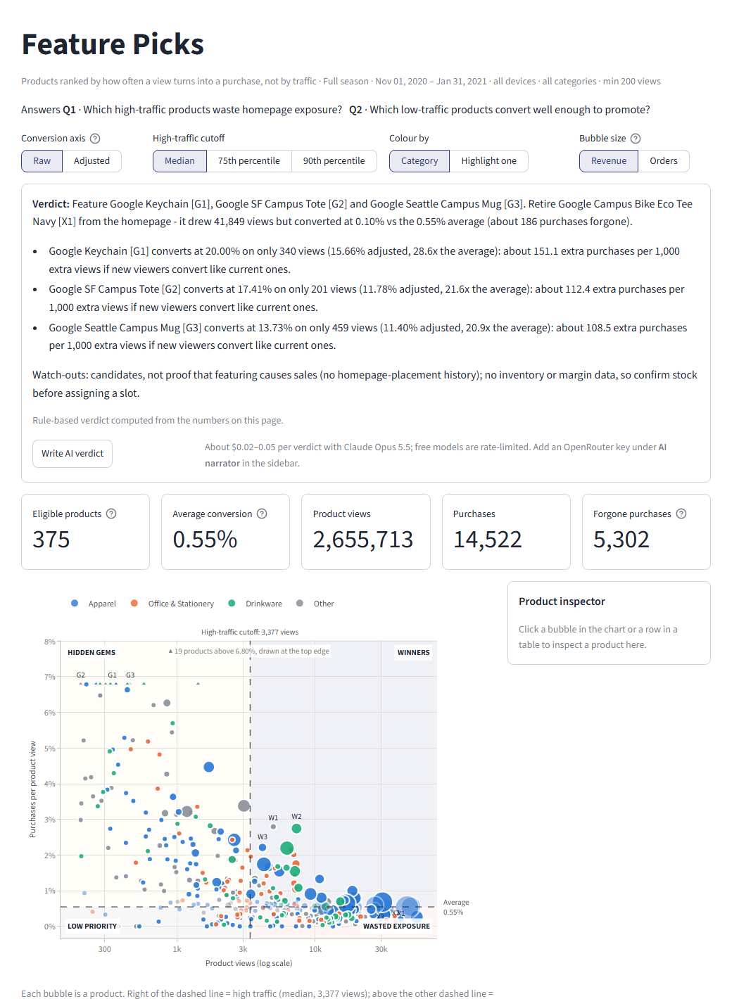
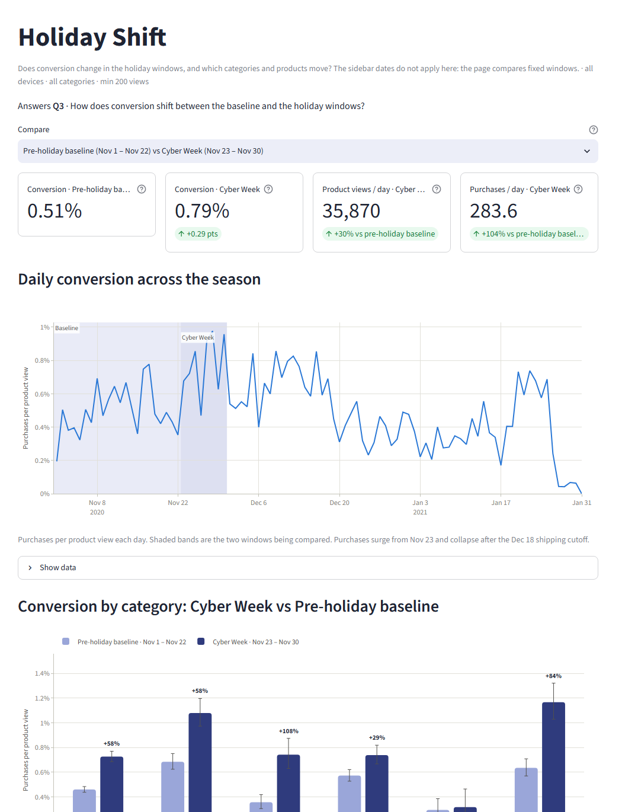
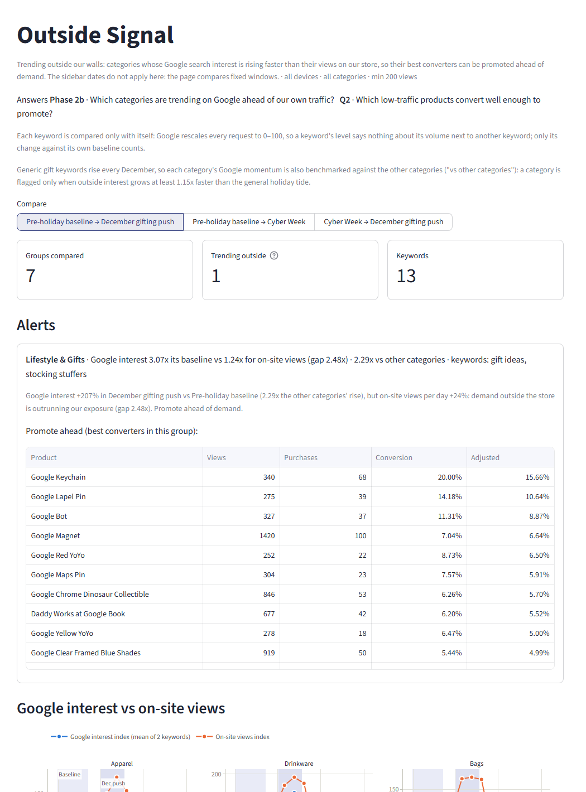
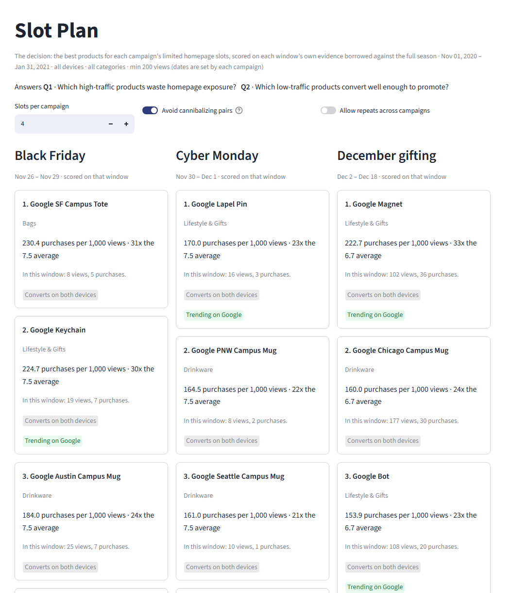

# Which Products Earn the Homepage?

**A Streamlit decision tool for the Google Merchandise Store** that ranks products by **view-to-purchase efficiency**, not raw traffic. It decides which SKUs should get the site's limited holiday homepage slots: Black Friday, Cyber Monday and the December gifting push.

*ITCS 5122 Visual Analytics · Team 9 · Account D · Pitch 1. Client: Head of Merchandising.*

> **Status:** working app with 7 pages, running on real GA4 data pulled live from BigQuery plus real Google Trends data. There are 339 automated tests, all passing. See [What is still missing](#what-is-still-missing).



---

## Quick start

```bash
conda activate ITCS5122             # or any Python >= 3.11 environment
pip install -r requirements.txt     # app runtime only
streamlit run app.py
```

The app runs entirely from the small snapshot files committed in `data/` (a few MB). It does **not** need BigQuery, the 450 MB CSV or an API key.

**Optional AI verdict.** The app turns the quadrant chart into a meeting-ready recommendation via [OpenRouter](https://openrouter.ai):

1. Copy `.streamlit/secrets.toml.example` to `.streamlit/secrets.toml`.
2. Set `OPENROUTER_API_KEY = "sk-or-v1-..."`. You can also paste a key into the sidebar's **AI narrator** box; it is kept for that session only.
3. Choose a model in the sidebar:

   | Model | Notes |
   |---|---|
   | `anthropic/claude-opus-5.5` | Default; about $0.02–0.05 per verdict |
   | `anthropic/claude-sonnet-5.5` | |
   | `anthropic/claude-haiku-5.5` | |
   | `anthropic/claude-fable-5.1` | |
   | `openrouter/free`, `google/gemma-4-31b-it:free` | Free; limited to 50 requests/day without credits |
   | A custom model id | |

Without a key, the app shows a deterministic rule-based verdict built from the same numbers. `.streamlit/secrets.toml` is git-ignored: never commit a key.

## What the app answers

| Page | Question from the pitch | Main view |
|---|---|---|
| **Feature Picks** | Q1: which products get lots of views but rarely sell? Q2: which convert well but stay hidden? | Quadrant bubble scatter: log product views × purchases per view, split into Hidden gems / Winners / Low priority / Wasted exposure. Adds a verdict card (rule-based or AI), ranked promote / retire / keep tables and a click-to-inspect product panel. |
| **Holiday Shift** | Q3: does the pattern shift during Black Friday / Cyber Monday? | Grouped bars of conversion by category, holiday window vs baseline, with 95% intervals. Adds daily conversion with shaded windows and the products that change quadrant. |
| **Device Split** | Q4: does it differ by device? | Heatmap of top candidates × device. Each cell's colour compares the product on that device with its own usual rate; a mobile-first / desktop-first call sits beside it. |
| **Outside Signal** | Phase 2b: "trending outside our walls" | Google search interest vs on-site views per category, both indexed to a baseline of 100, with alerts and promote-ahead lists. |
| **Cannibalization Check** | Phase 2a: does featuring A steal sales from B? | Spike days in A's share of views, then whether same-category peers sold less than their nearby pace, with relative-risk intervals. |
| **Slot Plan** | The decision | Black Friday / Cyber Monday / December slot cards with device lean, trend and cannibal flags; a retire list; CSV and Markdown export; an AI verdict for the plan. |
| **Data & Method** | Data abstraction (pitch slides 2 and 5) | Proof counts (CSV vs live BigQuery), cleaning steps with the real counts, category mapping, formulas, season windows, limits and all the SQL. |

**Shared sidebar filters:** season presets, date range, device, category group and a minimum-views threshold. Charts and tables update live. Pages that compare fixed windows disable the filters they ignore.

## Key results on the real data

Full season, all devices, minimum 200 product views:

- **Q2: promote these hidden gems.**
  - Google Keychain: 68 purchases on 340 views, **20.0%** vs the 0.55% average.
  - Google SF Campus Tote: 17.4%.
  - Google Seattle Campus Mug: 13.7%.
  - Campus mugs and small gifts dominate this list.
  - These are low-volume products: treat them as candidates to test, not guaranteed winners.
- **Q1: retire these from the homepage.**
  - Google Campus Bike Eco Tee Navy: **41,849 views at 0.10%**, about 186 purchases forgone.
  - Then Android Large Removable Sticker Sheet, YouTube Women's Favorite Tee White, Google Navy Speckled Tee and Android Large Trace Journal Black.
- **Q3: the holiday shift is real but uneven.**
  - Cyber Week converts at 0.79% vs 0.51% in the baseline.
  - Significant category lifts:
    - Bags: **+108%** (beyond the site-wide surge)
    - Lifestyle & Gifts: +84%
    - Apparel: +58%
    - Drinkware: +58%
    - Office & Stationery: +29%
  - Electronics & Accessories shows no clear change.
- **Q4: device doesn't change the picks.**
  - Desktop and mobile both convert at 0.55% (tablet 0.48%).
  - None of the top 20 candidates converts significantly better on one device, so one homepage line-up works for both.
- **2b: trending outside our walls.**
  - Lifestyle & Gifts: Google interest rose **3.07×** from the baseline to the December push, 2.3× the momentum of the other categories.
  - Its on-site views grew only 1.24×.
  - So promote its best converters (Keychain, Lapel Pin, Google Bot, …) ahead of demand.
- **2a: cannibalization.**
  - No pair is flagged once each peer is compared with its pace on nearby days.
  - A first version flagged several pairs, but the review showed those were seasonal artifacts.
  - Most pairs have too little data to test.
- **The slot plan:**

  | Campaign | Picks |
  |---|---|
  | Black Friday | Google SF Campus Tote, Google Keychain, Google Austin Campus Mug |
  | Cyber Monday | Google Lapel Pin, Google PNW Campus Mug, Google Seattle Campus Mug |
  | December gifting | Google Magnet, Google Chicago Campus Mug, Google Bot |

  It is exported as CSV or Markdown from the Slot Plan page.

| Holiday Shift | Device Split |
|---|---|
|  |  |
| **Outside Signal** | **Slot Plan** |
|  |  |

## Data

| Source | What it gives us |
|---|---|
| `bigquery-public-data.ga4_obfuscated_sample_ecommerce.events_*` | Event-level GA4 data with the nested `items` array, Nov 1 2020 – Jan 31 2021 (92 days). Pulled live. |
| `ga4_events_export.csv` (team export, 450 MB, **not in this repo**) | The same 4,295,584 events, but only 7 event-level columns and no item fields. Used for site-level context. |
| Google Trends | Daily US search interest for 13 keywords mapped to the store's category groups (`config/trends_keywords.csv`). |

**Proof it loads.** The pitch's query (`sql/proof_counts.sql`), re-run live, reproduces the slide exactly: **4,295,584 events · 270,154 users · 92 days**. The CSV gives the same counts, plus 360,129 sessions.

### What profiling the real data changed

1. **Products cannot be matched on `item_id`.** The obfuscated sample re-issues item ids across event types: 1,374 ids for 429 names.
   - A purchased item matches a viewed item **by id 1.1%** of the time, but **by name 93.2%**.
   - So products are keyed by a **normalised name**: HTML-unescaped, whitespace-collapsed, lowercased.
   - 8 legacy purchase-catalogue names are folded into their viewed product. For example, "Womens Google Striped LS" is "Google Women's Striped L/S" (`taxonomy.NAME_ALIASES`).
2. **A `view_item` event lists about 12 different products, not just the one viewed.**
   - List position carries no signal. Of the products bought in a session, 88% had appeared in a `view_item` list earlier in that session, but only 29% ever in the first position.
   - So a **product view = an appearance in a product-page view event**: 2.66M views across 420 products, about 0.55% pooled conversion.
   - That is the same scale as the pitch mock-up.
3. **Purchases are de-duplicated by transaction id.** There are 5,692 purchase events, but only 4,451 distinct transactions: 335 duplicates and 906 events without an id. Revenue after de-duplication is $339k.
4. **Add-to-cart was not tracked before Nov 25–26, 2020.** Only purchase ÷ view is compared across the season.
5. **Promotion events carry banner names, not products**, so the cannibalization check uses spikes in a product's share of views as its "featured" proxy.
6. **Season windows come from the data.** Purchases surge on Nov 23 and collapse after the Dec 18 shipping cutoff.

   | Window | Dates |
   |---|---|
   | Baseline | Nov 1–22 |
   | Cyber Week | Nov 23–30 |
   | Black Friday weekend | Nov 26–29 |
   | Cyber Monday | Nov 30–Dec 1 |
   | December gifting | Dec 2–18 |
   | Alternative 4-week baseline | Jan 4–31 |

## Metrics

| Metric | Definition |
|---|---|
| Conversion | purchases ÷ product views |
| Efficiency score | Empirical-Bayes shrunk rate `(P + m·μ_category)/(V + m)`. `m` is estimated by method of moments (≈70 on the real data, floored at 100 for stability). An 80% interval gives each product a confidence call. |
| Quadrants | x split: high-traffic cutoff (median views of eligible products; p75 and p90 also available). y split: pooled conversion. |
| Retire priority | Forgone purchases, `views × (average − adjusted rate)` |
| Promote priority | Extra purchases per 1,000 extra views, assuming new viewers convert like current ones |
| Holiday shift | Wilson intervals and two-proportion tests per category; quadrant movers |
| Device lean | Each product's conversion indexed to its device's baseline, with a binomial test (mobile vs desktop) |
| Cannibalization | Peer-adjusted expected purchases on A's spike days vs **B's pace on nearby non-spike days (±7 days)**, using a conditional binomial test with Benjamini–Hochberg q-values |
| Trending alert | Google momentum vs on-site view growth per category, benchmarked against the other categories so the generic December lift is discounted |

The full design is in [`docs/DESIGN.md`](docs/DESIGN.md).

## Data pipeline

These steps are only needed to rebuild the snapshots. All BigQuery queries are dry-run first and run under a byte cap; in total they used about 7 GiB of the free 1 TiB/month tier.

```bash
pip install -r requirements-pipeline.txt
python scripts/bq_auth.py --project <gcp-project-id>   # one-time browser sign-in + proof query
python scripts/profile_bigquery.py --with-event-params # items-array profiling -> data/profile.json
python scripts/export_bigquery.py                      # item x day x device exports -> data/raw/
python scripts/build_site_aggregates.py --csv ga4_events_export.csv   # DuckDB, ~5 s
python scripts/fetch_trends.py                         # Google Trends (cached per keyword)
python scripts/build_snapshots.py                      # -> data/item_daily, product_dim, manifest
python scripts/verify_snapshots.py                     # 17 hard checks against the pitch numbers
```

Notes on these steps:
- **Google Trends:** pytrends served all 13 keywords on 2026-10-20, while trendspy was rate-limited. Manually downloaded Trends CSVs in `data/trends_manual/` are the fallback.
- **Verification:** `verify_snapshots.py` checks that the snapshots reproduce the pitch counts and the site conversion rates: 1.18% baseline, 1.85% Cyber Week, 1.70% December, 1.47% full season.

## Tests

```bash
pip install -r requirements-dev.txt
python -m pytest -q
```

The suite covers:
- **Planted truths:** synthetic data with known hidden gems, wasted products, device leans, a cannibal pair and a trending category, which the metrics must recover.
- **Unit tests** for every module.
- **Real-data smoke tests.**
- **Streamlit `AppTest` runs** of all 7 pages.

## Project structure

```
app.py                 entry point: navigation, shared sidebar, snapshot guard
views/                 the 7 pages
ga4app/
  config.py            season windows, thresholds, validated colour palette, model list
  contracts.py         parquet/json schemas, validation, atomic writers
  metrics.py           shrinkage, quadrants, holiday shift, device lean, slot plan
  phase2.py            cannibalization tests, trend index and alerts
  charts.py            Plotly builders (colour-blind-checked palette, one axis per chart)
  narrative.py, llm.py rule-based verdict + OpenRouter streaming client
  taxonomy.py          name keys, legacy aliases, category groups
  trends.py            Google Trends adapters and parsing
  data.py, state.py, ui.py   snapshot loading/caching, sidebar state, shared UI
  synthetic.py         planted-truth test data
  bq.py                BigQuery auth, dry runs, byte-capped queries
sql/                   12 BigQuery queries (proof, profiling, exports)
scripts/               the pipeline above
data/                  committed snapshots; data/raw/ = raw exports + Trends cache
tests/                 pytest + AppTest
docs/DESIGN.md         full design: contracts, SQL, formulas, page specs
```

## What is still missing

| Area | Status |
|---|---|
| Live AI verdict | ⏳ **Not yet run against the real OpenRouter API.** It is tested with a mocked stream (parsing, errors, fallbacks). Needs an `OPENROUTER_API_KEY` to check end to end. |
| "Re-run proof query live" button (Data & Method) | ⏳ Only works on a machine with cached BigQuery credentials. It is disabled elsewhere and has not been clicked in the running app. |
| Deployment | ⏳ Not deployed. The app is ready for Streamlit Community Cloud, since it runs from the committed snapshots, and the key can go in the Cloud app's secrets. |
| Shareable filter URLs | ❌ Left out (`bind="query-params"` conflicted with the season presets), so links don't carry the sidebar filters. |
| Product inspector | Partial. It shows stats, interval, device lean, a timeline and a "pin to slot plan" button, but not the per-device bars from the design. |
| Slot Plan | It has cards and tables but no chart. |
| `TEAM9.pdf` (original pitch deck) | Intentionally not committed. |

## Known limitations

- **No placement history, inventory or margin data.** The app recommends candidates; it cannot prove featuring causes sales, and it optimises conversion, not profit.
- **"Views" are appearances in product-page view lists** (about 12 products per event), because the obfuscated sample doesn't record the product actually viewed.
  - Small products bought through other paths can show very high rates (e.g. Google Keychain: 68 purchases on 340 views).
  - The shrinkage and the 80% interval guard against noise, not against this definition.
- **The holiday windows are short** (Black Friday weekend is 4 days; Cyber Monday is 2). Slot scores lean on each product's full-season rate, adjusted by how its category moved in the window.
- **Cannibalization flags are correlational.** Purchases cluster by day, so the p- and q-values are optimistic; treat a flag as a prompt to check.
- **Google Trends values are normalised 0–100 per request.** Each keyword is compared only with itself.
- **Generic gift keywords rise every December**, so alerts are benchmarked against the other categories.
- **The pre-holiday baseline has only 22 days** (the data starts Nov 1). A January 4-week window is offered as the alternative.
- **The sample is obfuscated by Google.** Read relative patterns, not exact business totals.

## Existing analyses, and how this goes further

| Existing analysis | What it does | How this goes further |
|---|---|---|
| [rupalchopra16/Google-Analytics-Web-Analysis-using-Python](https://github.com/rupalchopra16/Google-Analytics-Web-Analysis-using-Python) | Session-level funnel, cohorts, devices | Works at item/SKU level for a placement decision |
| [guiarpi/GA4-funnel-analysis](https://github.com/guiarpi/GA4-funnel-analysis) | Static matplotlib funnel charts | An interactive tool tied to one decision |
| [Inna Koliandra's Tableau dashboard](https://public.tableau.com/app/profile/inna.koliandra/viz/EcommerceFunnelAnalysisGA4/Dashboard1) | Session funnel with filters | Adds item-level ranking, shrinkage, cannibalization tests and an external Google Trends signal |

---

*The data is Google's public obfuscated GA4 sample. This is a student project, not affiliated with Google.*
