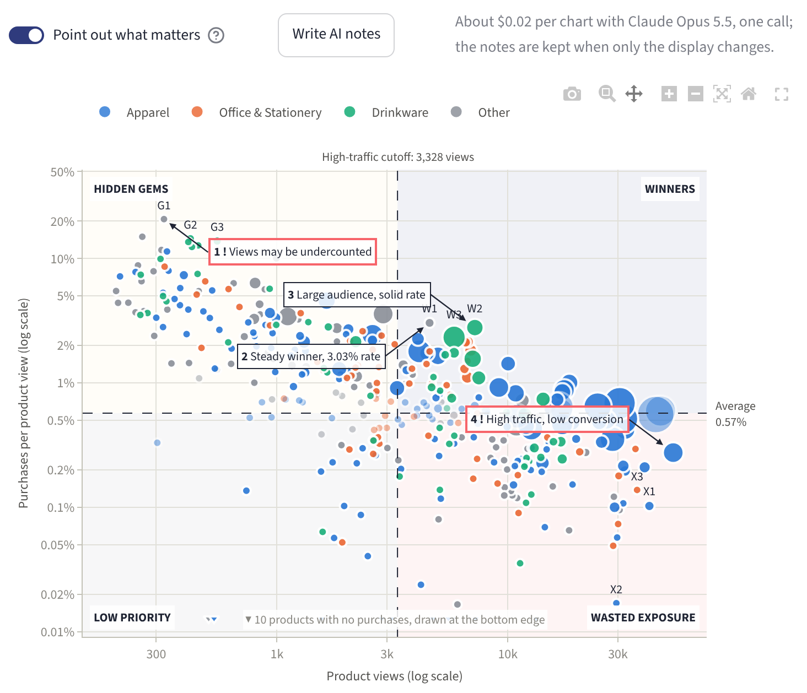
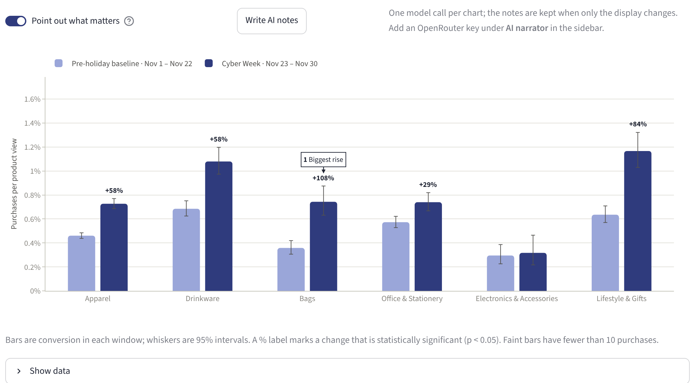
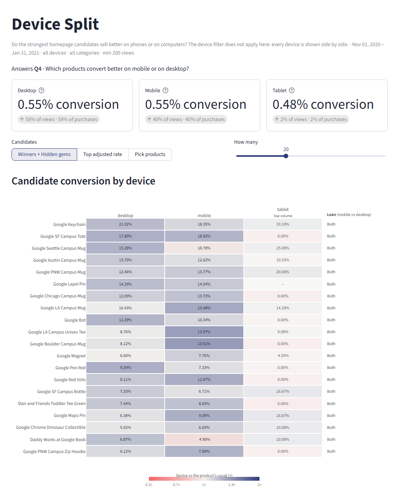

# Which Products Earn the Homepage?

**A Streamlit decision tool for the Google Merchandise Store** that ranks products by **view-to-purchase efficiency**, not raw traffic. It decides which SKUs should get the site's limited holiday homepage slots: Black Friday, Cyber Monday and the December gifting push.

*ITCS 5122 Visual Analytics · Team 9 · Account D · Pitch 1. Client: Head of Merchandising.*

> **Status:** working app with 7 pages, running on real GA4 data pulled live from BigQuery plus real Google Trends data. An optional AI verdict and [AI chart notes](#chart-notes) have both been run live against OpenRouter. There are 465 automated tests, all passing, run on every push by GitHub Actions.

**Live app: <https://which-earns-the-homepage.streamlit.app/>** (nothing to install; or run it locally, see [Quick start](#quick-start)).


---

## Quick start

The quickest way to see the app is the hosted version: <https://which-earns-the-homepage.streamlit.app/>. To run it on your own machine instead:

The app runs entirely from the small data files committed in `data/` (about 5 MB). It does **not** need BigQuery, the 450 MB CSV or an API key.

**You need Python 3.11, 3.12, 3.13 or 3.14** (3.13 recommended). Check with `python --version`, or on Windows `py -0`, which lists every installed version. **Python 3.15 does not work yet:** the pinned numpy, pandas and scipy have no ready-made packages for it, so pip would try to compile them and fail. Install 3.13 from [python.org](https://www.python.org/downloads/) alongside it if needed.

**1. Get the code.**

```bash
git clone https://github.com/AbelV0538/which-products-earn-the-homepage.git
cd which-products-earn-the-homepage
```

Without git: on the GitHub page choose **Code → Download ZIP**, unzip it, and open a terminal in the unzipped folder.

**2. Create an environment and install the packages** (once; about 3 minutes).

Windows (PowerShell or Command Prompt):

```bat
py -3.13 -m venv .venv
.venv\Scripts\python -m pip install -r requirements.txt
```

On Windows, keep the project in a short folder path, such as `C:\Users\you\homepage`. Streamlit installs some deeply nested files, and Windows limits paths to 260 characters unless long paths are turned on, so a long path (for example a ZIP extracted into `…\which-products-earn-the-homepage-main\which-products-earn-the-homepage-main`) can make the install fail.

macOS or Linux:

```bash
python3.13 -m venv .venv
.venv/bin/python -m pip install -r requirements.txt
```

These commands call the environment's own Python, so there is nothing to activate. If `py -3.13` or `python3.13` is not found, use `python -m venv .venv` (Windows) or `python3 -m venv .venv` (macOS or Linux) instead, as long as that Python is 3.11–3.14. With conda instead: `conda create -n homepage python=3.13 -y`, then `conda activate homepage` and `pip install -r requirements.txt`; in step 3, run plain `streamlit run app.py` in that activated environment.

**3. Start the app.**

```bash
.venv\Scripts\python -m streamlit run app.py      # Windows
.venv/bin/python -m streamlit run app.py          # macOS or Linux
```

The app opens in your browser at <http://localhost:8501> (if it doesn't, open that address yourself). **The first page takes 20–30 seconds** while it loads the data and runs the cannibalization tests once; after that, pages switch in about a second. Stop the app with **Ctrl+C** in the terminal. To start it again later, run step 3 from the same folder.

Tested on 2026-11-17 by following these steps from a fresh clone on Windows with Python 3.13; all 7 pages load. The packages also install from ready-made wheels on macOS (Apple silicon and Intel) and Linux, for Python 3.11 to 3.14.

**Or skip the install: open it in GitHub Codespaces.** The repo has a dev container (`.devcontainer/devcontainer.json`, Python 3.11). On GitHub choose **Code → Codespaces → Create codespace**: it installs `requirements.txt`, starts the app and opens it on port 8501.

**Optional AI verdict and chart notes.** With an [OpenRouter](https://openrouter.ai) key, the app turns the quadrant chart into a meeting-ready recommendation and writes [notes on three charts](#chart-notes):

1. Copy `.streamlit/secrets.toml.example` to `.streamlit/secrets.toml`.
2. Set `OPENROUTER_API_KEY = "sk-or-v1-..."`. You can also paste a key into the sidebar's **AI narrator** box (kept for that session only), or, in Codespaces, add `OPENROUTER_API_KEY` as a Codespaces secret: the app also reads the environment variable.
3. Choose a model in the sidebar:

   | Model | Notes |
   |---|---|
   | `anthropic/claude-opus-5.5` | Default; about $0.02–0.05 per verdict and $0.02 per chart's notes (measured: $0.021). OpenRouter holds `max_tokens` × price first, so keep about $0.10 of credit available |
   | `anthropic/claude-sonnet-5.5` | |
   | `anthropic/claude-haiku-5.5` | About $0.001 per verdict or chart's notes (measured), 4–7 s |
   | `anthropic/claude-fable-5.1` | |
   | `openrouter/free`, `google/gemma-4-31b-it:free` | Free; limited to 50 requests/day without credits. Slower (8–60 s); reasoning models sometimes use up their token budget, and Gemma's shared pool was rate-limited throughout the test on 2026-11-17 |
   | A custom model id | |

Without a key, the app shows a deterministic rule-based verdict and rule-based chart notes, built from the same numbers. `.streamlit/secrets.toml` is git-ignored: never commit a key.

## What the app answers

| Page | Question from the pitch | Main view |
|---|---|---|
| **Feature Picks** | Q1: which products get lots of views but rarely sell? Q2: which convert well but stay hidden? | Quadrant bubble scatter: log product views × purchases per view (log or linear), split into Hidden gems / Winners / Low priority / Wasted exposure. Adds a verdict card (rule-based or AI), ranked promote / retire / keep tables with data-quality flags, and a click-to-inspect product panel with per-device bars. |
| **Holiday Shift** | Q3: does the pattern shift during Black Friday / Cyber Monday? | Grouped bars of conversion by category, holiday window vs baseline, with 95% intervals. Adds daily conversion with shaded windows and the products that change quadrant. |
| **Device Split** | Q4: does it differ by device? | Heatmap of top candidates × device. Each cell's colour compares the product on that device with its own usual rate; a mobile-first / desktop-first call sits beside it. |
| **Outside Signal** | Phase 2b: "trending outside our walls" | Google search interest vs on-site views per category, both indexed to a baseline of 100, with alerts and promote-ahead lists. |
| **Cannibalization Check** | Phase 2a: does featuring A steal sales from B? | Spike days in A's share of views, then whether same-category peers sold less than their nearby pace, with relative-risk intervals. |
| **Slot Plan** | The decision | Black Friday / Cyber Monday / December slot cards with an 80% range, how much of each score comes from the window itself, and device-lean, trend, cannibal and data-quality badges. A candidates chart shows how far ahead of the alternatives each pick is. Products can be pinned or excluded (e.g. out of stock). Also a retire list, CSV and Markdown export, and an AI verdict for the plan. |
| **Data & Method** | Data abstraction (pitch slides 2 and 5) | Proof counts (CSV vs live BigQuery), cleaning steps with the real counts, category mapping, formulas, season windows, limits and all the SQL. |

Three charts can also point out what matters themselves: see [Chart notes](#chart-notes).

**Shared sidebar filters:** season presets, date range, device, category group and a minimum-views threshold. Charts and tables update live. Pages that compare fixed windows disable the filters they ignore. The filters are kept in the page URL (for example `?preset=cyber_week&dev=mobile&minv=500`), so a link reproduces the view.

## Chart notes

The Feature Picks scatter, the Holiday Shift bars and the Device Split heatmap have a **Point out what matters** toggle (off by default). It draws up to four numbered notes on the chart, at the bubbles, bars or cells that matter for the homepage decision, and lists them under the chart. Cautions (views that look under-counted, a significant drop, a weak device) get a coral border and a "!".

- **Rule-based notes work without a key.** Feature Picks points at the best hidden gem [G1], the top winner [W1] and the product with the most purchases forgone [X1], and flags a featured pick whose views look under-counted. Holiday Shift points at the largest significant rise and drop. Device Split points at the favoured device of up to two mobile-first or desktop-first products, then at the strongest remaining cell.
- **Write AI notes** asks the sidebar's model to choose the notes instead. The app offers it a fixed list of anchors (product codes, `category·window` bars, `code·device` cells) with their numbers, and the model can point only at those. Measured on the real data: Claude Opus 5.5 about $0.02 and 5 s per chart; Claude Haiku 5.5 under $0.001, with all 24 notes in the final test run passing the checks (details in [DESIGN.md 7b](docs/DESIGN.md)).
- **Every note is checked before it is drawn.** The anchor must be one the app offered, and every number in the text must be a rounding of a number in that anchor's data or the chart's scope. A note that fails is dropped, and the page says which and why. If none survive, or the call fails, the rule-based notes are shown with a warning.
- **The app places the notes, not the model.** Arrows point at the drawn bubble (a clipped bubble's arrow goes to the edge), bar notes sit above the lift label, and heatmap notes outline the cell with a numbered badge. Boxes that would overlap move to the other side of their point or stack.
- **AI notes are cached** by the anchors and the model. Switching only how the chart is drawn (log or linear scale, bubble size, colour) re-places the same notes without a new call.
- On Feature Picks, each product note has an **Inspect** button that opens the product inspector.

| Feature Picks, live AI notes (Claude Haiku 5.5) | Holiday Shift, rule-based note |
|---|---|
|  |  |

## Key results on the real data

Full season (Nov 1 – Jan 25, the last day with product-level purchases), all devices, minimum 200 product views:

- **Q2: promote these hidden gems.**
  - Google Keychain: 67 purchases on 324 views, **20.7%** vs the 0.57% average.
  - Google Seattle Campus Mug: 14.5%.
  - Google Austin Campus Mug: 13.8%.
  - Campus mugs and small gifts dominate this list.
  - These are low-volume products: treat them as candidates to test, not guaranteed winners.
  - All five top gems carry the **"views under-counted"** flag: checkout events listing them reach at least half their product views (the store average is 1 per 35). Shoppers reach them without a product page, so their real conversion is lower than shown.
- **Q1: retire these from the homepage.**
  - Google Campus Bike Eco Tee Navy: **41,040 views at 0.10%**, about 192 purchases forgone.
  - Then YouTube Women's Favorite Tee White, Android Large Removable Sticker Sheet, Google Navy Speckled Tee and Google Tee Green.
- **Q3: the holiday shift is real but uneven.**
  - Cyber Week converts at 0.79% vs 0.51% in the baseline.
  - Significant category lifts:
    - Bags: **+108%** (beyond the site-wide surge)
    - Lifestyle & Gifts: +84%
    - Apparel: +58%
    - Drinkware: +58%
    - Office & Stationery: +29%
  - Electronics & Accessories shows no clear change.
- **Q4: device doesn't change the picks.**
  - Desktop and mobile both convert at 0.57% (tablet 0.50%).
  - None of the top 20 candidates converts significantly better on one device, so one homepage line-up works for both.
- **2b: trending outside our walls.**
  - Lifestyle & Gifts: Google interest rose **3.07×** from the baseline to the December push, 2.3× the momentum of the other categories.
  - Its on-site views grew only 1.24×.
  - So promote its best converters (Keychain, Lapel Pin, Google Bot, …) ahead of demand.
- **2a: cannibalization.**
  - No pair is "Likely cannibalized" once each peer is compared with its pace on nearby days.
  - Two pairs are "Possible" (p < 0.05, but q = 0.29 after the multiple-testing correction): Android Iconic Pin with Google Sunglasses, and with Noogler Android Figure. Neither product is in the slot plan.
  - A first version flagged several pairs, but the review showed those were seasonal artifacts.
  - Most pairs have too little data to test.
- **The slot plan** (default 4 slots per campaign):

  | Campaign | Picks |
  |---|---|
  | Black Friday | Google Keychain, Google Austin Campus Mug, Google LA Campus Unisex Tee, Google Seattle Campus Mug |
  | Cyber Monday | Google Lapel Pin, Google PNW Campus Mug, Google LA Campus Mug, Google Chicago Campus Mug |
  | December gifting | Google Magnet, Google Bot, Google Pen Red, Google Maps Pin |

  - Every Black Friday and Cyber Monday pick rests on 8–30 views inside its 2–4 day window, so those scores are mostly each product's full-season rate. The page marks them "Mostly season evidence" and shows an 80% range per slot.
  - The December picks have 46–108 window views each, so the window itself carries about a third to a half of each score.
  - It is exported as CSV or Markdown from the Slot Plan page.

| Holiday Shift | Device Split |
|---|---|
|  |  |
| **Outside Signal** | **Slot Plan** |
|  |  |

## Data

| Source | What it gives us |
|---|---|
| `bigquery-public-data.ga4_obfuscated_sample_ecommerce.events_*` | Event-level GA4 data with the nested `items` array, Nov 1 2020 – Jan 31 2021 (92 days). Pulled live. |
| `ga4_events_export.csv` (team export, 450 MB, **not in this repo**) | The same 4,295,584 events, but only 7 event-level columns and no item fields. Used for site-level context. |
| Google Trends | Daily US search interest for 13 keywords mapped to the store's category groups (`config/trends_keywords.csv`). |

**Proof it loads.** The pitch's query (`sql/proof_counts.sql`), re-run live, reproduces the slide exactly: **4,295,584 events · 270,154 users · 92 days**. The CSV gives the same counts, plus 360,129 sessions.

### What profiling the real data changed

1. **Products cannot be matched on `item_id`.** The obfuscated sample re-issues item ids across event types: 1,374 ids for 429 names.
   - A purchased item matches a viewed item **by id 1.1%** of the time, but **by name 93.2%**.
   - So products are keyed by a **normalised name**: HTML-unescaped, whitespace-collapsed, lowercased.
   - 8 legacy purchase-catalogue names are folded into their viewed product. For example, "Womens Google Striped LS" is "Google Women's Striped L/S" (`taxonomy.NAME_ALIASES`).
2. **A `view_item` event lists about 12 different products, not just the one viewed.**
   - List position carries no signal. Of the products bought in a session, 88% had appeared in a `view_item` list earlier in that session, but only 29% ever in the first position.
   - So a **product view = an appearance in a product-page view event**: 2.53M views across 420 products through Jan 25, about 0.57% pooled conversion.
   - That is the same scale as the pitch mock-up.
3. **Purchases are de-duplicated by transaction id.** There are 5,692 purchase events, but only 4,451 distinct transactions: 335 duplicates and 906 events without an id. Revenue after de-duplication is $339k.
4. **Add-to-cart was not tracked before Nov 25–26, 2020.** Only purchase ÷ view is compared across the season.
5. **Promotion events carry banner names, not products**, so the cannibalization check uses spikes in a product's share of views as its "featured" proxy.
6. **Season windows come from the data.** Purchases surge on Nov 23 and collapse after the Dec 18 shipping cutoff.

   | Window | Dates |
   |---|---|
   | Full season | Nov 1 – Jan 25 |
   | Baseline | Nov 1–22 |
   | Cyber Week | Nov 23–30 |
   | Black Friday weekend | Nov 26–29 |
   | Cyber Monday | Nov 30–Dec 1 |
   | December gifting | Dec 2–18 |
   | January baseline (alternative) | Jan 4–25 |
7. **Item-level purchases stop on Jan 26, 2021.**
   - The site still records 19–69 purchase events a day through Jan 31, but the item-level purchases drop to 53, 12, 10, 16, 11 and 0.
   - Through Jan 25, every day has at least 1.13 item rows per purchase event (an order lists about 2.7 products); from Jan 26 it is below 1.
   - Counting those days would read them as days nobody bought anything. That pulled the full-season average down from 0.57% to 0.55% and moved 14 products between quadrants. It also made the old January baseline (Jan 4–31) read 0.39% conversion; on Jan 4–25 it is 0.47%.
   - So every product-level number stops on Jan 25 (`config.ITEM_DATA_END`). Site-level counts (the proof query, the CSV cross-checks) still cover all 92 days. `verify_snapshots.py` checks that the cut sits exactly where the item data ends.

## Metrics

| Metric | Definition |
|---|---|
| Conversion | purchases ÷ product views |
| Efficiency score | Empirical-Bayes shrunk rate `(P + m·μ_category)/(V + m)`. `m` is estimated by method of moments (≈66 on the real data, floored at 100 for stability). An 80% interval gives each product a confidence call. |
| Quadrants | x split: high-traffic cutoff (median views of eligible products; p75 and p90 also available). y split: pooled conversion. |
| Retire priority | Forgone purchases, `views × (average − adjusted rate)` |
| Promote priority | Extra purchases per 1,000 extra views, assuming new viewers convert like current ones |
| Campaign score (Slot Plan) | `(P_w + m·s·u)/(V_w + m)`: the window's own purchases blended with the full-season rate `s` times the category's window uplift `u`, with an 80% range. `V_w/(V_w + m)` is the share of the score that comes from the window; below one half the slot is marked "Mostly season evidence" |
| Under-counted views flag | Checkout events listing the product ≥ half its product views. A warning only: it never changes a score |
| Holiday shift | Wilson intervals and two-proportion tests per category; quadrant movers |
| Device lean | Each product's conversion indexed to its device's baseline, with a binomial test (mobile vs desktop) |
| Cannibalization | Peer-adjusted expected purchases on A's spike days vs **B's pace on nearby non-spike days (±7 days)**, using a conditional binomial test with Benjamini–Hochberg q-values |
| Trending alert | Google momentum vs on-site view growth per category, benchmarked against the other categories so the generic December lift is discounted |

The full design is in [`docs/DESIGN.md`](docs/DESIGN.md).

## Data pipeline

These steps are only needed to rebuild the snapshots. All BigQuery queries are dry-run first and run under a byte cap; in total they used about 7 GiB of the free 1 TiB/month tier.

```bash
pip install -r requirements-pipeline.txt
python scripts/bq_auth.py --project <gcp-project-id>   # one-time browser sign-in + proof query
python scripts/profile_bigquery.py --with-event-params # items-array profiling -> data/profile.json
python scripts/export_bigquery.py                      # item x day x device exports -> data/raw/
python scripts/build_site_aggregates.py --csv ga4_events_export.csv   # DuckDB, ~5 s
python scripts/fetch_trends.py                         # Google Trends (cached per keyword)
python scripts/build_snapshots.py                      # -> data/item_daily, product_dim, manifest
python scripts/verify_snapshots.py                     # 18 checks (13 hard) against the pitch numbers
```

Notes on these steps:
- **Google Trends:** pytrends served all 13 keywords on 2026-10-20, while trendspy was rate-limited. Manually downloaded Trends CSVs in `data/trends_manual/` are the fallback.
- **Verification:** `verify_snapshots.py` checks that the snapshots reproduce the pitch counts and the site conversion rates: 1.18% baseline, 1.85% Cyber Week, 1.70% December, 1.47% over all 92 days. It also checks that item-level purchases end exactly on `config.ITEM_DATA_END`.

## Tests

```bash
pip install -r requirements-dev.txt
python -m pytest -q
```

The suite covers:
- **Planted truths:** synthetic data with known hidden gems, wasted products, device leans, a cannibal pair and a trending category, which the metrics must recover.
- **Unit tests** for every module.
- **Real-data smoke tests**, including the Jan 25 item-data cut.
- **Streamlit `AppTest` runs** of all 7 pages, plus the URL filters and pinning / excluding products in the slot plan.
- **Chart notes:** the number check (roundings pass; invented, computed or misplaced numbers fail), unknown and duplicate anchors, lenient parsing, the rule-based notes passing their own checks on synthetic and real data, placement on log axes and clipped bubbles, and AppTest runs with an offline fake model that check display controls never trigger a second call.

GitHub Actions (`.github/workflows/tests.yml`) runs the same suite on every push and pull request.

## Project structure

```
app.py                 entry point: navigation, shared sidebar, snapshot guard
views/                 the 7 pages
assets/                the logo: sidebar wordmark and collapsed-sidebar icon
ga4app/
  config.py            season windows, thresholds, validated colour palette, model list
  contracts.py         parquet/json schemas, validation, atomic writers
  metrics.py           shrinkage, quadrants, holiday shift, device lean, slot plan
  phase2.py            cannibalization tests, trend index and alerts
  charts.py            Plotly builders (colour-blind-checked palette, one axis per chart)
  narrative.py, llm.py rule-based verdict + OpenRouter streaming client
  annotate.py          chart notes: anchors, number check, rule-based and AI notes
  taxonomy.py          name keys, legacy aliases, category groups
  trends.py            Google Trends adapters and parsing
  data.py, state.py, ui.py   snapshot loading/caching, sidebar state, shared UI
  synthetic.py         planted-truth test data
  bq.py                BigQuery auth, dry runs, byte-capped queries
sql/                   12 BigQuery queries (proof, profiling, exports)
scripts/               the pipeline above
data/                  committed snapshots; data/raw/ = raw exports + Trends cache
tests/                 pytest + AppTest
docs/DESIGN.md         full design: contracts, SQL, formulas, page specs (7b: chart notes and the live run)
docs/PLAN_ai_chart_notes.md   the build plan for the chart notes, with what changed while building
docs/screenshots/      the README images
.devcontainer/         GitHub Codespaces setup (installs requirements.txt, starts the app)
.github/workflows/     CI: snapshot checks + the test suite on every push
```

## Known limitations

- **No placement history, inventory or margin data.** The app recommends candidates; it cannot prove featuring causes sales, and it optimises conversion, not profit.
- **"Views" are appearances in product-page view lists** (about 12 products per event), because the obfuscated sample doesn't record the product actually viewed.
  - Small products bought through other paths can show very high rates (e.g. Google Keychain: 67 purchases on 324 views, but 370 checkout events).
  - The shrinkage and the 80% interval guard against noise, not against this definition. The "views under-counted" flag marks the products this most likely affects.
- **Item-level purchases end on Jan 25, 2021** although the export runs to Jan 31, so product-level analysis stops there (see [What profiling the real data changed](#what-profiling-the-real-data-changed), item 7).
- **The holiday windows are short** (Black Friday weekend is 4 days; Cyber Monday is 2). Slot scores lean on each product's full-season rate, adjusted by how its category moved in the window.
- **Cannibalization flags are correlational.** Purchases cluster by day, so the p- and q-values are optimistic; treat a flag as a prompt to check.
- **Google Trends values are normalised 0–100 per request.** Each keyword is compared only with itself.
- **Generic gift keywords rise every December**, so alerts are benchmarked against the other categories.
- **The pre-holiday baseline has only 22 days** (the data starts Nov 1). A January window of the same length (Jan 4–25) is offered as the alternative.
- **The sample is obfuscated by Google.** Read relative patterns, not exact business totals.

## Existing analyses, and how this goes further

| Existing analysis | What it does | How this goes further |
|---|---|---|
| [rupalchopra16/Google-Analytics-Web-Analysis-using-Python](https://github.com/rupalchopra16/Google-Analytics-Web-Analysis-using-Python) | Session-level funnel, cohorts, devices | Works at item/SKU level for a placement decision |
| [guiarpi/GA4-funnel-analysis](https://github.com/guiarpi/GA4-funnel-analysis) | Static matplotlib funnel charts | An interactive tool tied to one decision |
| [Inna Koliandra's Tableau dashboard](https://public.tableau.com/app/profile/inna.koliandra/viz/EcommerceFunnelAnalysisGA4/Dashboard1) | Session funnel with filters | Adds item-level ranking, shrinkage, cannibalization tests and an external Google Trends signal |

---

*The data is Google's public obfuscated GA4 sample. This is a student project, not affiliated with Google.*
